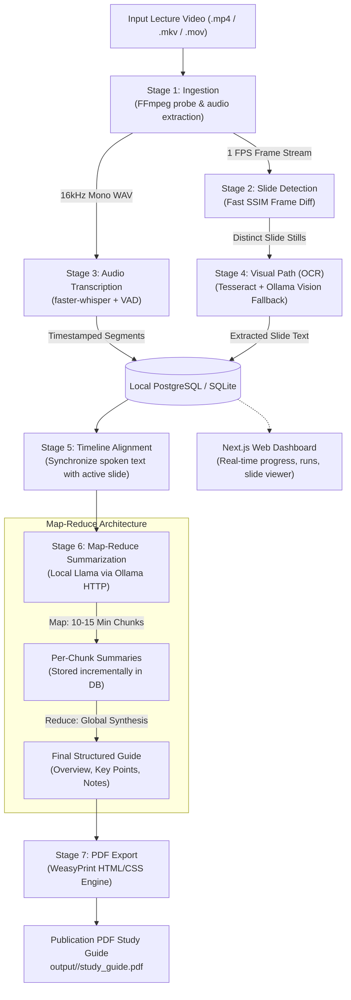
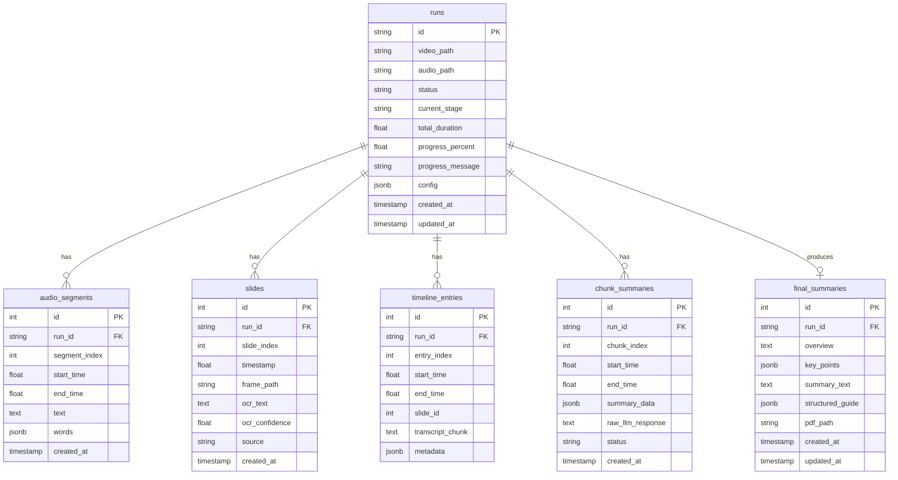

# Architecture & System Design Document
## Local Offline Lecture Video to Study Guide Pipeline

---

## 1. Executive Summary & Core Philosophy

The **Lecture Video to Study Guide Pipeline** is a fully local, offline, multimodal processing system designed to transform long-form recorded academic lectures (typically 1 to 3+ hours of screen capture and spoken audio) into structured, publication-grade PDF study guides containing executive overviews, key concepts, detailed lecture notes, and slide visual references.

### Core Philosophy
* **100% Offline & Zero-Cloud**: No third-party cloud APIs, no external SaaS dependencies, and zero outbound network traffic. All Automatic Speech Recognition (ASR), Optical Character Recognition (OCR), Vision-Language Models (VLM), and Large Language Models (LLM) run entirely on local compute.
* **Privacy & Compliance**: Safe for proprietary lecture materials, unreleased academic research, FERPA-regulated student recordings, and confidential corporate briefings.
* **Fault-Tolerant & Incremental**: Processes multi-hour media streams without excessive memory spikes (OOM) and incrementally checkpoints all intermediate states to a local database. A crash or interruption at any point allows resuming without restarting earlier stages.
* **Modular Stage Isolation**: Every pipeline stage operates as an independent script/module that can be inspected, executed, or re-run in isolation.

---

## 2. Problem Statement & Solution

### The Problems Being Solved

1. **Information Density & Review Friction in Long Videos**:
   A 3-hour lecture recording contains an overwhelming amount of information (~25,000–35,000 spoken words and dozens of visual slides). Re-watching or manually scrubbing video timelines to prepare for exams or review complex concepts is inefficient and time-consuming.

2. **The "Pure Audio" Deficit**:
   Standard transcription tools (e.g., standard Whisper transcripts) only capture spoken audio. Academic lectures rely heavily on non-verbal visual context: mathematical formulas, diagrams, architectural charts, pseudocode, and slide bullet points. Without visual data, transcriptions lack context when speakers say "as you can see here" or "this equation shows".

3. **Compute Waste in Video Processing (Frame Redundancy)**:
   A 3-hour video at 30 FPS consists of **324,000 frames**. Running OCR or vision models across every frame is computationally impossible on local hardware. Most lecture frames are static for minutes at a time while the lecturer speaks.

4. **OCR Failure on Non-Standard Academic Content**:
   Traditional OCR engines (like Tesseract) perform well on high-contrast, horizontal standard text, but fail severely or produce gibberish on handwritten annotations, complex equations, diagrams, and low-contrast slides.

5. **LLM Context Limits & Hallucination over Long Texts**:
   Feeding an uncurated 35,000-word transcript directly into a standard local LLM context window leads to truncation, "lost in the middle" phenomena, or degraded synthesis quality.

6. **Cloud Privacy & Cost Barriers**:
   Uploading gigabytes of 1080p/4K lecture videos to cloud multimodal APIs (OpenAI, Google Gemini, AWS Transcribe) incurs significant API costs, requires high upload bandwidth, and violates data privacy policies in many universities and enterprises.

---

### The Solution Overview

| Challenge | Pipeline Solution |
| :--- | :--- |
| **324,000 redundant video frames** | **Perceptual SSIM Slide Detection**: Samples frames at 1 FPS and detects slide transitions using Structural Similarity (SSIM). Compresses hours of video into only 30–70 high-value distinct slide stills. |
| **Audio missing visual context** | **Multimodal Timeline Alignment**: Merges time-coded audio segments with active slide intervals into a unified chronological knowledge stream. |
| **OCR failure on equations/diagrams** | **Two-Tier Visual Path**: Fast Tesseract OCR with an automated quality heuristic. If confidence is low or character ratios detect non-text, it falls back to a local Ollama Vision-LLM (`llama3.2-vision`). |
| **35,000+ word LLM context limits** | **Slide-Aware Map-Reduce**: Divides the synchronized timeline into natural 10–15 minute slide-boundary chunks. The **Map** step summarizes each chunk; the **Reduce** step synthesizes the complete, unified study guide. |
| **Pipeline crashes during 3-hour runs** | **Incremental Database Checkpointing**: Every slide, transcribed audio segment, and chunk summary is immediately committed to PostgreSQL (with SQLite fallback). Resuming automatically skips completed work. |
| **Cloud dependence & privacy** | **100% Local Inference**: Runs `faster-whisper` (CTranslate2), local `tesseract`, and local `llama3` / `llama3.2-vision` via Ollama. |
| **Final readable output** | **WeasyPrint PDF Generation**: Synthesizes the final Markdown output and slide catalog into an academic PDF layout using HTML5/CSS3 templates. |

---

## 3. High-Level Architecture

The system is organized into **7 sequential stages** governed by a central CLI/API orchestrator, backed by a persistent relational database, and paired with a modern Next.js web application.



---

## 4. Detailed Stage-by-Stage Breakdown

### Stage 1: Ingestion (`pipeline/ingest.py`)
* **Role**: Analyzes the input container and prepares the raw streams without loading entire multi-gigabyte video files into RAM.
* **Video Probe**: Uses `ffprobe` (falling back to OpenCV `VideoCapture`) to extract video duration, dimensions, FPS, and stream codecs.
* **Audio Extraction**: Invokes `ffmpeg` to extract a single-channel, 16,000 Hz, 16-bit PCM uncompressed WAV file (`audio.wav`). This is the exact native input required by Whisper, bypassing downstream audio re-sampling.
* **Frame Streaming Generator**: Exposes `stream_sampled_frames()` which yields `(timestamp, frame)` at a configurable rate (default `1.0 FPS`). It reads one frame at a time, keeping memory usage constant (~few megabytes).

### Stage 2: Slide Detection (`pipeline/slides.py`)
* **Role**: Filters out identical consecutive frames so only real slide changes are captured.
* **Fast SSIM Metric**: Converts sampled frames to grayscale, resizes them to 320x180 for high computational throughput, and computes the Structural Similarity Index (SSIM) using Gaussian blur smoothing and luminance/contrast equations.
* **Debounce Logic**: A slide change is confirmed only if `SSIM < SLIDE_SSIM_THRESHOLD` (default 0.85) and the time elapsed since the previous slide exceeds `MIN_SLIDE_DURATION_SEC` (default 3.0s), preventing duplicate slides caused by speaker arm gestures or laser pointers.
* **Output**: Distinct slides are saved as high-resolution JPEG images (`output/<run_id>/slides/slide_XXXX_YYYYYYs.jpg`) and registered in the database.

### Stage 3: Audio Path / Transcription (`pipeline/transcribe.py`)
* **Role**: Converts spoken lecture audio into clean, timestamped text segments.
* **Engine**: Powered by `faster-whisper` (CTranslate2 re-implementation of Whisper).
  * **Device Strategy**: Automatically uses `cuda` (model: `large-v3`, float16) if an NVIDIA GPU is present; otherwise falls back to `cpu` (model: `medium`, int8 quantization for high performance on Apple Silicon or modern CPUs).
* **Language & Voice Activity Detection (VAD)**:
  * Explicitly passes `language="en"` (avoids hallucination and auto-detect overhead).
  * Enables `vad_filter=True` with `min_silence_duration_ms=500` to suppress silence, background white noise, and lecture hall coughing.
* **Incremental Commits**: Commits batches of 10 segments to the database as transcription progresses. If interrupted, it resumes from the last transcribed timestamp.

### Stage 4: Visual Path / OCR & Vision Fallback (`pipeline/ocr.py`)
* **Role**: Extracts textual content from each detected slide frame.
* **Tier 1 — Tesseract OCR**:
  * Applies image pre-processing (Grayscale conversion + CLAHE contrast enhancement).
  * Runs Tesseract with confidence extraction across bounding words.
* **Quality Heuristic (`assess_ocr_quality`)**:
  * Minimum character length check (`len(text) >= 15`).
  * Alphanumeric character ratio (`alpha_chars / total_chars >= 0.50`).
  * Average word confidence score (`conf >= 45.0%`).
* **Tier 2 — Local Vision-LLM Fallback**:
  * If the slide fails quality heuristics (e.g., mathematical formulas, architecture diagrams, handwritten notes, charts), the slide is sent to Ollama running a vision model (`llama3.2-vision` or `llava`).
  * Prompts the vision model to transcribe equations, code blocks, diagrams, and bullet points into clean Markdown.
* **Incremental Database Update**: Saves the slide text, confidence score, and source (`tesseract` vs. `ollama_vision`) to the database.

### Stage 5: Timeline Alignment (`pipeline/align.py`)
* **Role**: Synchronizes the visual slide timeline with the spoken audio segments.
* **Interval Association**:
  * Constructs time windows $[T_{\text{slide}_i}, T_{\text{slide}_{i+1}})$ for all detected slides.
  * Assigns each audio segment to the slide interval that was visible on screen when the speaker spoke those words based on segment midpoint timestamps.
* **Output**: Generates a chronological list of timeline blocks stored in the `timeline_entries` table. Each block connects the slide image, its OCR/Vision text, and the spoken lecture transcript for that exact duration.

### Stage 6: Map-Reduce Summarization (`pipeline/summarize.py`)
* **Role**: Synthesizes the full lecture into an academic study guide without exceeding the context window of local LLMs.
* **Slide-Boundary Chunking**:
  * Chunks timeline entries into segments of ~10 to 15 minutes (`CHUNK_MIN_SECONDS = 600`, `CHUNK_TARGET_SECONDS = 720`, `CHUNK_MAX_SECONDS = 900`).
  * **Crucial Rule**: Chunks split *strictly* at slide boundaries, never mid-sentence or mid-slide.
* **Map Step**:
  * For each 10–15 minute chunk, prompts local Llama 3 via Ollama (`http://localhost:11434`) with the combined slide text and spoken transcript.
  * Outputs a structured per-chunk summary: key concepts, definitions, formulas, and slide references.
  * Saved incrementally to `chunk_summaries` in the database.
* **Reduce Step**:
  * Collects all chunk summaries and invokes Ollama to synthesize the global study guide.
  * Produces three standard components:
    1. **Executive Overview**: High-level lecture summary and objectives.
    2. **Key Takeaways & Core Themes**: Bulleted essential takeaways and major exam topics.
    3. **Comprehensive Section-by-Section Study Notes**: Full detailed notes with timestamp markers, formulas, and slide references.

### Stage 7: PDF Export (`pipeline/render_pdf.py`)
* **Role**: Formats the synthesized lecture guide and slide imagery into an academic PDF document.
* **Templating**: Jinja2 processes `templates/study_guide.html` and `templates/style.css`.
* **Markdown Parser**: A fast, local Markdown parser converts LLM headers, bullet lists, bold text, code blocks, and blockquotes into clean HTML without external network dependencies.
* **PDF Compilation**: Uses **WeasyPrint** (Cairo/Pango engine) to compile publication-grade PDFs with page numbering, print CSS rules, responsive typography, and embedded slide visuals.
* **Output**: Writes the final artifact to `output/<run_id>/study_guide.pdf`.

---

## 5. Database Schema & Fault-Tolerant Resumption

The database layer (`pipeline/db.py`) handles persistence across runs. It prioritizes **PostgreSQL** (via `psycopg` v3 with JSONB support) and includes an automatic zero-config **SQLite** fallback (`output/lecture_guide.db`) if PostgreSQL is not running.

### Entity Relationship Diagram



### Resumption Mechanics
* When a pipeline run is started with `--resume` (the default), each stage queries the database:
  * **Slide Detection**: Reads `MAX(timestamp)` from `slides` and resumes frame sampling from that point.
  * **Transcription**: Queries `MAX(end_time)` from `audio_segments` and skips previously transcribed segments.
  * **OCR**: Queries `slides WHERE ocr_text IS NULL` and only processes unprocessed slides.
  * **Summarization**: Queries `chunk_summaries` and only runs the Map step for incomplete chunk indices.
  * **PDF Export**: Re-compiles from the latest database records without re-running ASR or LLM inference.

---

## 6. Next.js Web Dashboard & API

The workspace includes a web application in `web/` built with Next.js (App Router), TypeScript, and CSS, allowing non-CLI users to monitor and interact with pipeline runs.

```
web/
├── src/
│   ├── app/
│   │   ├── api/
│   │   │   ├── pipeline/start/    # POST: Trigger a new pipeline execution
│   │   │   ├── runs/              # GET: List runs; GET [id]: Detailed run status
│   │   │   ├── slides/            # GET: Serve slide frame images
│   │   │   └── upload/            # POST: Handle video file uploads
│   │   ├── components/            # UI components (Header, RunCard, StageProgress)
│   │   ├── runs/[id]/page.tsx     # Detailed view of a run with slide gallery & logs
│   │   ├── page.tsx               # Main Dashboard: upload, active jobs, history
│   │   └── globals.css            # Dark mode UI styling & glassmorphism tokens
```

---

## 7. Technology Stack & Dependencies

| Layer | Technology | Purpose |
| :--- | :--- | :--- |
| **Language** | Python 3.10+ | Core pipeline orchestration, computer vision, and data pipelines |
| **Audio/Video Ingestion** | FFmpeg & FFprobe (system) | Demuxing, codec probing, and 16kHz WAV audio extraction |
| **Video Processing** | OpenCV (`opencv-python`), NumPy | Video frame sampling and SSIM frame difference detection |
| **Speech Recognition** | `faster-whisper` (CTranslate2) | High-speed, local Whisper speech-to-text with VAD filtering |
| **OCR (Optical Character)** | Tesseract OCR (`pytesseract`) | Fast local text extraction from slide frames |
| **Vision-LLM Fallback** | Ollama (`llama3.2-vision`) | Multimodal interpretation of complex diagrams, equations, and slides |
| **Summarization LLM** | Ollama (`llama3:latest`) | Local Map-Reduce summarization and study guide synthesis |
| **Database Persistence** | PostgreSQL (`psycopg` v3) / SQLite | Incremental state checkpointing and resumability |
| **PDF Generation** | WeasyPrint, Jinja2 | HTML5/CSS3 template rendering to publication PDF |
| **Frontend Dashboard** | Next.js 15, React, TypeScript | Web interface for run management and study guide reading |

---

## 8. Configuration & Environment Variables

All settings can be configured via environment variables or a `.env` file at the root:

```ini
# --- Output & Paths ---
OUTPUT_DIR=output
TEMPLATES_DIR=templates

# --- Database Selection ---
DB_TYPE=postgres            # "postgres" or "sqlite"
POSTGRES_HOST=localhost
POSTGRES_PORT=5432
POSTGRES_DB=lecture_guide
POSTGRES_USER=postgres
POSTGRES_PASSWORD=
SQLITE_PATH=output/lecture_guide.db

# --- Ollama Configuration ---
OLLAMA_BASE_URL=http://localhost:11434
OLLAMA_MODEL=llama3:latest
OLLAMA_VISION_MODEL=llama3.2-vision
OLLAMA_TIMEOUT=180

# --- Faster-Whisper Configuration ---
WHISPER_MODEL=medium         # "medium" for CPU/Apple Silicon, "large-v3" for CUDA
WHISPER_DEVICE=auto          # "auto", "cpu", "cuda"
WHISPER_COMPUTE_TYPE=auto    # "auto", "int8", "float16"

# --- Slide Detection Tuning ---
FRAME_SAMPLE_FPS=1.0         # Sample 1 frame per second
SLIDE_SSIM_THRESHOLD=0.85    # SSIM below 0.85 indicates a slide transition
MIN_SLIDE_DURATION_SEC=3.0   # Minimum duration before allowing a new slide

# --- OCR Quality Heuristics ---
TESSERACT_CMD=tesseract
OCR_MIN_CHARS=15
OCR_MIN_ALPHA_RATIO=0.5

# --- Map-Reduce Chunking (seconds) ---
CHUNK_MIN_SECONDS=600        # 10 minutes
CHUNK_TARGET_SECONDS=720     # 12 minutes
CHUNK_MAX_SECONDS=900        # 15 minutes
```

---

## 9. Usage & Operational Runbook

### Prerequisites
1. **System packages**:
   * macOS: `brew install ffmpeg tesseract pango cairo libffi`
   * Ubuntu/Debian: `sudo apt-get install ffmpeg tesseract-ocr libpango-1.0-0 libcairo2 libffi-dev`
2. **Ollama**:
   * Install from [ollama.ai](https://ollama.ai) and pull required models:
     ```bash
     ollama pull llama3
     ollama pull llama3.2-vision
     ```

### Running the End-to-End Pipeline
```bash
# Process a video from start to finish
python main.py run path/to/lecture.mp4

# Run with a custom run identifier
python main.py run path/to/lecture.mp4 --run-id cs229_lecture_01
```

### Running Individual Stages Independently
```bash
# Check the status of a run
python main.py status cs229_lecture_01

# Stage 1: Extract audio and probe
python main.py ingest path/to/lecture.mp4 --run-id cs229_lecture_01

# Stage 2: Detect slides
python main.py slides path/to/lecture.mp4 --run-id cs229_lecture_01

# Stage 3: Transcribe audio
python main.py transcribe cs229_lecture_01

# Stage 4: Run OCR & Vision fallback on slides
python main.py ocr cs229_lecture_01

# Stage 5: Align audio and slides
python main.py align cs229_lecture_01

# Stage 6: Summarize with Ollama
python main.py summarize cs229_lecture_01

# Stage 7: Compile PDF
python main.py export-pdf cs229_lecture_01
```

### Generating Synthetic Demo Data
To test the pipeline on a machine without a real lecture video:
```bash
python scripts/create_demo_lecture.py
# Generates sample_data/demo_lecture.mp4 with 3 synthetic slides and audio
python main.py run sample_data/demo_lecture.mp4 --run-id demo_test
```

### Running the Web Dashboard
```bash
cd web
npm install
npm run dev
# Open http://localhost:3000 in your browser
```
